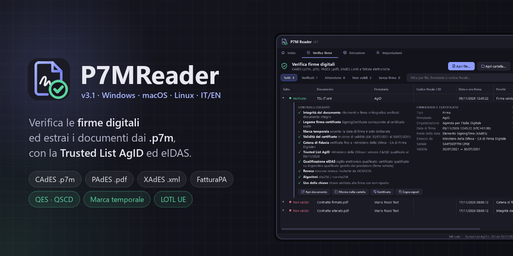
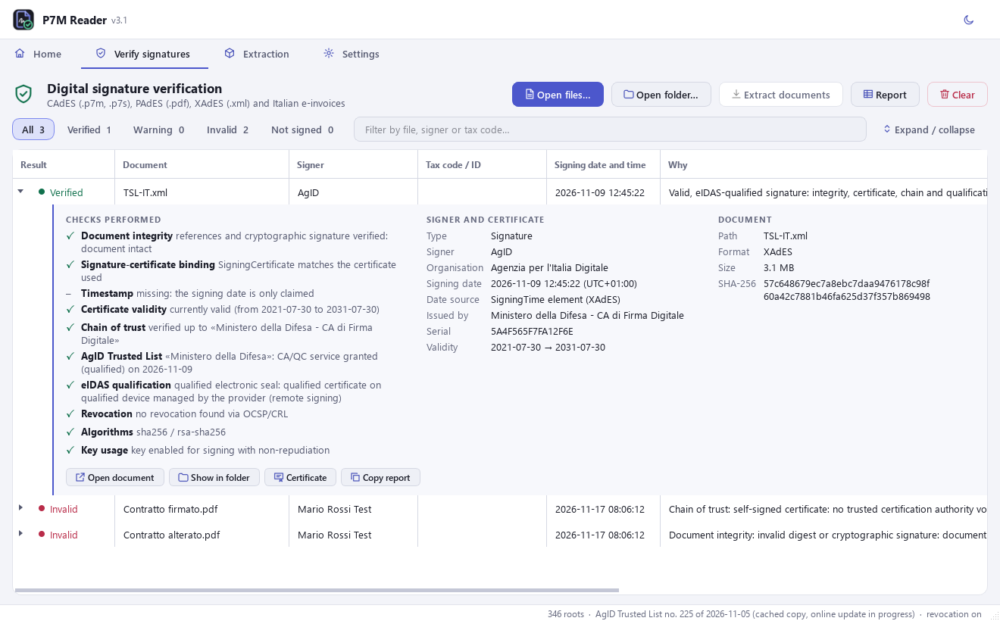

<p align="center">
  
</p>

<p align="center">
  <a href="README.md">Italiano</a> · <b>English</b>
</p>

# P7MReader

**Digital signature verification and document extraction from `.p7m` envelopes, one at a time or by the thousand.**
Checks CAdES (`.p7m`, `.p7s`), PAdES (signed PDFs) and XAdES (`.xml`, Italian FatturaPA e-invoices) signatures with a chain of trust to the **Italian AgID Trusted List (eIDAS)**, tells you *why* each signature is valid or not, and extracts the documents with a clean file name — **your files never leave your computer**.



## Download

From the **[Releases](https://github.com/KonjikiNoYami1991/P7MReader/releases/latest)** page:

| System | File | Notes |
|---|---|---|
| Windows 11 (also 10) | `P7MReader-<version>-windows-x64.exe` | Single executable, no installation |
| macOS 12+ up to macOS 26 Tahoe (Apple Silicon / Intel) | `P7MReader-<version>-macOS-arm64.dmg` / `-x86_64.dmg` | Unsigned app: see [first start on macOS](#first-start-on-macos) |
| Linux x86_64 | `P7MReader-<version>-x86_64.AppImage` or `-linux-x86_64.tar.gz` | See [Linux](#linux) below |

### First start on macOS

The app is not signed by a registered Apple developer, so the first start has to be allowed once:

- **macOS 15 Sequoia and later** (macOS 26 Tahoe included): open the app, dismiss the warning, then *System Settings → Privacy & Security → Open Anyway* and confirm. The old *right click → Open* no longer works there.
- **macOS 12-14**: *right click the app → Open → Open*.

Or, from Terminal, after copying it to Applications:

```bash
xattr -dr com.apple.quarantine /Applications/P7MReader.app
```

The release's `SHA256SUMS.txt` lists the fingerprints to check the downloads:

```bash
sha256sum -c SHA256SUMS.txt --ignore-missing
```

## Linux

There are two packages with the same program inside. They work on x86_64 desktop distributions with glibc 2.35 or later: from the latest releases (Ubuntu 26.04 LTS and 26.10, Fedora 45, Debian 13, Linux Mint 22, openSUSE Leap 16 and Tumbleweed, Arch, RHEL/AlmaLinux/Rocky 10) back to Ubuntu 22.04, Debian 12 and Leap 15.6; the [per-distribution table](#distribution-by-distribution) says what each one needs). Neither needs administrator rights.

| Package | When to choose it |
|---|---|
| **AppImage** | A single file to download and run, no installation. Handy to try it out or keep it on a USB stick |
| **tar.gz** | A real per-user installation: application menu entry, icon, `p7mreader` command in the terminal, files open with *Open with…* |

### AppImage: run without installing

```bash
chmod +x P7MReader-*-x86_64.AppImage
```

```bash
./P7MReader-*-x86_64.AppImage
```

Or from the file manager: *Properties → Permissions → Allow executing file as program*, then double click.

The AppImage uses the current static runtime: **`libfuse2` is not needed**, only the `fusermount` program from the **`fuse3`** package, already present on almost every desktop. If you see `No suitable fusermount binary found on the $PATH`, install it:

```bash
sudo apt install fuse3
```

(Fedora, RHEL, Arch and openSUSE: package `fuse3` with `dnf`, `pacman` or `zypper`). Or, without installing anything:

```bash
./P7MReader-*-x86_64.AppImage --appimage-extract-and-run
```

**Adding it to the application menu** (optional): the easiest way is an AppImage manager such as *Gear Lever* (Flathub) or *AppImageLauncher*. By hand:

```bash
mkdir -p ~/Applications ~/.local/share/applications ~/.local/share/icons/hicolor/256x256/apps
mv P7MReader-*-x86_64.AppImage ~/Applications/P7MReader.AppImage
cd ~/Applications && ./P7MReader.AppImage --appimage-extract p7mreader.png
mv squashfs-root/p7mreader.png ~/.local/share/icons/hicolor/256x256/apps/ && rm -rf squashfs-root
cat > ~/.local/share/applications/p7mreader.desktop <<EOF
[Desktop Entry]
Type=Application
Name=P7MReader
Exec="$HOME/Applications/P7MReader.AppImage" %F
Icon=p7mreader
Categories=Office;Viewer;Security;
MimeType=application/pkcs7-mime;application/pkcs7-signature;application/pdf;application/xml;
Terminal=false
EOF
```

To update, replace `~/Applications/P7MReader.AppImage` with the new version.

### tar.gz: install for the current user

```bash
tar -xzf P7MReader-*-linux-x86_64.tar.gz
```

```bash
cd P7MReader-*-linux-x86_64
```

```bash
./installa-linux.sh
```

The script copies the program to `~/.local/opt/p7mreader`, creates the `p7mreader` command in `~/.local/bin` and adds the entry with its icon to the application menu. From then on P7MReader also appears in *Open with…* for `.p7m`, `.p7s`, PDF and XML files. The extracted folder can be deleted.

If the terminal says `p7mreader` is not found, `~/.local/bin` is not in your `PATH` (on some distributions this lasts until you log out and back in). You can add it with:

```bash
echo 'export PATH="$HOME/.local/bin:$PATH"' >> ~/.bashrc
```

- **Update**: extract the new version's `.tar.gz` and run `./installa-linux.sh` again. It replaces the program and keeps your settings.
- **Uninstall**: from the extracted folder, `./installa-linux.sh --rimuovi`. Settings and cache stay in `~/.config/P7MReader`: delete it by hand to remove everything.
- **Without installing**: after extracting, you can run `./P7MReader/P7MReader` directly.

### Distribution by distribution

What you need, in short, on the main families. *Packages* = AppImage and tar.gz; *Source* = [running from source](#running-from-source-on-linux) with Python.

| Family | Examples | Packages | Source |
|---|---|---|---|
| Debian / Ubuntu | Debian 13 and 12, Ubuntu 26.10, 26.04, 24.04, 22.04, Mint 22 and 21, Pop!_OS, elementary, Zorin | Yes | Yes (Debian 12 and Ubuntu 22.04: Python too old, use `uv`) |
| Fedora | Fedora 45 and 44 (Workstation, KDE), Nobara, Bazzite | Yes | Yes |
| Red Hat | RHEL, AlmaLinux, Rocky 10 | Yes | Yes |
| Red Hat 9 | RHEL, AlmaLinux, Rocky 9 | **No** (glibc 2.34) | Yes, with `python3.12` |
| Arch | Arch, Manjaro, EndeavourOS, CachyOS, Garuda | Yes | Yes |
| openSUSE | Tumbleweed, Leap 16.0 and 15.6 | Yes | Yes |
| Others | Alpine, Void musl (musl, not glibc) | **No** | Yes |

The packages already contain Python and Qt: from the system they need at most **`fuse3`** (AppImage only, usually already there) and a few **X11 graphics libraries** that can be missing on minimal desktops. Running from source always needs the graphics libraries, because PyQt6 installed with `pip` takes them from the system.

#### Debian, Ubuntu, Linux Mint and derivatives

FUSE for the AppImage:

```bash
sudo apt install fuse3
```

Graphics libraries (if the `xcb` plugin error shows up, and always for running from source):

```bash
sudo apt install libegl1 libgl1 libxkbcommon-x11-0 libxcb-cursor0 libxcb-icccm4 libxcb-image0 libxcb-keysyms1 libxcb-render-util0 libxcb-shape0 libxcb-xkb1
```

Running from source also needs:

```bash
sudo apt install python3-venv git
```

#### Fedora

```bash
sudo dnf install fuse3
```

```bash
sudo dnf install mesa-libEGL mesa-libGL libxcb libxkbcommon-x11 xcb-util-cursor xcb-util-wm xcb-util-image xcb-util-keysyms xcb-util-renderutil
```

For running from source (Python with `venv` is already included):

```bash
sudo dnf install python3 git
```

On **Fedora Atomic** (Silverblue, Kinoite, Bazzite…) the AppImage with *Gear Lever* is the easiest choice, or run from source inside `toolbox`.

#### RHEL, AlmaLinux, Rocky Linux

**Version 10** behaves like Fedora: same `dnf` commands as above.

**Version 9** has glibc 2.34, older than the required 2.35: AppImage and tar.gz **do not start** (`GLIBC_2.35 not found` error). Run from source with Python 3.12 (available since 9.4):

```bash
sudo dnf install python3.12 git mesa-libEGL mesa-libGL libxcb libxkbcommon-x11 xcb-util-cursor xcb-util-wm xcb-util-image xcb-util-keysyms xcb-util-renderutil
```

If `xcb-util-cursor` is not found, enable EPEL (`sudo dnf install epel-release`) and try again. In the [running from source](#running-from-source-on-linux) commands, write `python3.12` instead of `python3`.

#### Arch Linux, Manjaro, EndeavourOS, CachyOS

```bash
sudo pacman -S --needed fuse3
```

```bash
sudo pacman -S --needed libglvnd libxcb libxkbcommon-x11 xcb-util-cursor xcb-util-wm xcb-util-image xcb-util-keysyms xcb-util-renderutil
```

For running from source:

```bash
sudo pacman -S --needed python git
```

Arch does not allow `pip install` into the system Python (PEP 668): the virtual environment described below is the right way. There is also `python-pyhanko` on the AUR, but it can lag behind the version on PyPI.

#### openSUSE Tumbleweed and Leap

```bash
sudo zypper install fuse3
```

```bash
sudo zypper install libglvnd libxkbcommon-x11-0 libxcb-cursor0 libxcb-icccm4 libxcb-image0 libxcb-keysyms1 libxcb-render-util0 libxcb-shape0 libxcb-xkb1
```

For running from source on Tumbleweed and Leap 16:

```bash
sudo zypper install python3 python3-pip git
```

On Leap 15.6 the default Python is 3.6: install 3.12 and use `python3.12` instead of `python3` in the commands below.

```bash
sudo zypper install python312 python312-pip git
```

#### Other distributions

- **NixOS**: start the AppImage with `appimage-run` (`nix-shell -p appimage-run --run "appimage-run ./P7MReader-*-x86_64.AppImage"`).
- **Alpine, Void musl** and other musl-based distributions: the packages do not work (they are built for glibc). Running from source remains, if the distribution provides PyQt6 for musl.
- **ARM (aarch64, Raspberry Pi…)**: there are no prebuilt packages; running from source works where `pip` finds PyQt6 for that architecture.

### Running from source on Linux

After installing your distribution's system packages (see above):

```bash
git clone https://github.com/KonjikiNoYami1991/P7MReader.git
```

```bash
cd P7MReader
```

```bash
python3 -m venv .venv
```

```bash
.venv/bin/pip install PyQt6 pyhanko pyhanko-certvalidator asn1crypto cryptography lxml certifi tzdata
```

```bash
.venv/bin/python P7MReader.py
```

To check that everything is fine, `.venv/bin/python P7MReader.py --selftest` ends with exit code 0 and prints `[OK]` for every check.

**Python too old** (Debian 12, Ubuntu 22.04, Leap 15.x without `python312`…)? [`uv`](https://docs.astral.sh/uv/) downloads a recent Python into your user folder by itself, without touching the system one. Instead of the `venv` and `pip` commands:

```bash
curl -LsSf https://astral.sh/uv/install.sh | sh
```

```bash
uv venv --python 3.13 .venv
```

```bash
uv pip install --python .venv PyQt6 pyhanko pyhanko-certvalidator asn1crypto cryptography lxml certifi tzdata
```

Then start it as above, with `.venv/bin/python P7MReader.py`.

**A `p7mreader` command** for the source version (optional), from the `P7MReader` folder:

```bash
mkdir -p ~/.local/bin && printf '#!/bin/sh\nexec "%s/.venv/bin/python" "%s/P7MReader.py" "$@"\n' "$PWD" "$PWD" > ~/.local/bin/p7mreader && chmod +x ~/.local/bin/p7mreader
```

**Updating**: `git pull` in the folder, then the `pip install` command again with `--upgrade`.

### If the program does not open

- Start it from a terminal to see the error message. Errors are also written to `~/.config/P7MReader/errori.log`.
- `could not load the Qt platform plugin "xcb"`: a system graphics library is missing, usually `libxcb-cursor0` (`sudo apt install libxcb-cursor0`; on Fedora `xcb-util-cursor`).
- It works on X11 and Wayland. If the window misbehaves on Wayland, try forcing X11: `QT_QPA_PLATFORM=xcb p7mreader`.

## Language

The interface is in **Italian** when the operating system is in Italian, and in **English** otherwise. It can be set manually in *Settings → Appearance → Language* (applies from the next start).

## How to use it

1. **Drag** files or folders onto the window, or use *Choose files…* / *Choose a folder…*.
2. Choose **Verify signatures** or **Extract documents**: the table fills up while the program works.
3. **Expand a row** (double click, or Enter) to see every check performed, the signer, the certificate and the document.
4. From there: open or extract the document, open/export the certificate, see the e-invoice summary, copy the report.
5. *Report* exports everything to **CSV** (Excel) or to an **HTML** page.

Files and folders passed on the command line are opened right away:

```bash
P7MReader.exe document.pdf.p7m "C:\Signed deeds"
```

### Keyboard shortcuts

| Keys | Action |
|---|---|
| `Ctrl+O` | Open files |
| `Ctrl+Shift+O` | Open folder |
| `Ctrl+F` | Go to the table filter |
| `Ctrl+1` … `Ctrl+4` | Home, Verification, Extraction, Settings |
| `Enter` / `Space` | Expand or collapse the selected row |
| `Menu` / `Shift+F10` | Row actions (open, extract, certificate, copy…) |
| `Esc` | Cancel the running operation |
| `Tab` / `Shift+Tab` | Move between controls (the highlighted border shows where you are) |

## The verification engine

For every signature (and countersignature) these checks are performed and shown:

| Check | What it verifies |
|---|---|
| **Document integrity** | Content digest and cryptographic signature (RSA, RSA-PSS, ECDSA, EdDSA). For PDFs also **changes after signing**; for XAdES references, transforms and `SignedInfo` |
| **Signature-certificate binding** | `signing-certificate` attribute (CAdES/PAdES) or `SigningCertificate` (XAdES) |
| **Timestamp** | RFC 3161 token truly verified: digest, token signature, TSA certificate. When valid, the signature is assessed **at that date**; an **eIDAS qualified** timestamp is reported as such |
| **Certificate validity** | At the timestamp date or (optionally) at the claimed signing date for expired certificates |
| **Chain of trust** | Up to a root in the AgID Trusted List, the Windows store or the CAs you added; missing intermediates are downloaded via AIA |
| **AgID Trusted List** | Status of the certification authority **at signing time**, using the list history (services later withdrawn or suspended are reported) |
| **eIDAS qualification** | Certificate QcStatements + Trusted List qualifications (QSCD, signature or seal, policy criteria): **qualified electronic signature (QES)**, qualified seal, advanced signature with qualified certificate, remote signing… |
| **Revocation** | OCSP/CRL (soft-fail: if servers do not answer the result becomes *Warning* and says so) |
| **Algorithms / key usage** | Weak algorithms (SHA-1, MD5, RSA < 2048) and whether the certificate is enabled for signing |

The result is **Verified**, **Warning** or **Invalid**, always with the reason (the first failed check).

### A Trusted List you can trust

The AgID Trusted List is downloaded at every start (with a cached copy and a copy bundled in the program for offline use) and **is not used unless it is authentic**:

1. its XAdES signature is verified;
2. the certificate that signed it must be among those the **European Commission** publishes for Italy in the *List of Trusted Lists* (LOTL);
3. an expired list (*NextUpdate* passed) is reported.

A downloaded copy with an invalid signature or an unknown signer is rejected; a tampered local copy is never loaded. The status is shown in *Settings → Trusted roots* and in the status bar.

> P7MReader is a technical verification tool: it is not a *qualified validation service* under Article 33 of the eIDAS Regulation and its results have no legal value by themselves.

## Extraction

- `.p7m` envelopes, also **nested** (double signature) or **base64/PEM**.
- **Clean name**: `.pdf (1) (1).p7m`, `.p7m (2)`, ` - Copia` are removed; the extension comes from the content (PDF, Office, ODF, images, XML…).
- Same name and same content = *Already present*; different content = `document (2).pdf`.
- Output next to the originals or in a folder of your choice; optionally deletes the `.p7m` after a successful extraction (never if the signature is invalid, always after confirmation).

## Accessibility

Designed following **WCAG 2.1 level AA**, without changing the look:

- **everything works from the keyboard** (see the shortcuts) and the **focus is always visible** when using the keyboard;
- **accessible names and descriptions** for screen readers (NVDA, Narrator, JAWS); coloured results always come with text, and check details are read in full;
- **text contrast of at least 4.5:1** in both themes (light and dark);
- text follows the **size set in Windows** (*Accessibility → Text size*);
- **animations** can be turned off and stay off when animation effects are disabled in Windows;
- the HTML report uses table headers, document language and text alternatives for symbols.

## Running from source

Requires **Python 3.12+** (tested with 3.13 and 3.15). On Linux follow [running from source on Linux](#running-from-source-on-linux), with the system packages for each distribution.

```bash
pip install PyQt6 pyhanko pyhanko-certvalidator asn1crypto cryptography lxml certifi tzdata
```

```bash
python P7MReader.py
```

Automatic check (modules, Trusted List, interface), exit code 0 when everything is fine:

```bash
python P7MReader.py --selftest
```

To force a language, set `P7MREADER_LANG=en` or `P7MREADER_LANG=it`.

## Building the executable

Windows (single exe with icon and version info; runs the self-test and prints the SHA-256 at the end):

```bash
build_p7mreader.bat
```

macOS and Linux (`.app` + `.dmg`, or AppImage + `.tar.gz`):

```bash
./build_p7mreader.sh
```

Releases are built automatically on GitHub Actions when a `v*` tag (e.g. `v3.1.0`) is pushed, for Windows, macOS and Linux.

## Where data is stored

| What | Where (Windows) |
|---|---|
| Settings | `%APPDATA%\P7MReader\impostazioni.json` |
| Cached AgID Trusted List and EU LOTL | `%APPDATA%\P7MReader\TSL-IT.xml`, `eu-lotl.xml` |
| Error log | `%APPDATA%\P7MReader\errori.log` |

On macOS and Linux the folder is `~/.config/P7MReader`.

**Network connections**: only to the AgID Trusted List, the European Commission LOTL and the OCSP/CRL/AIA servers named in the certificates. Documents are never sent anywhere.

## License

Released under the **GNU GPL v3.0** — see [LICENSE](LICENSE).
