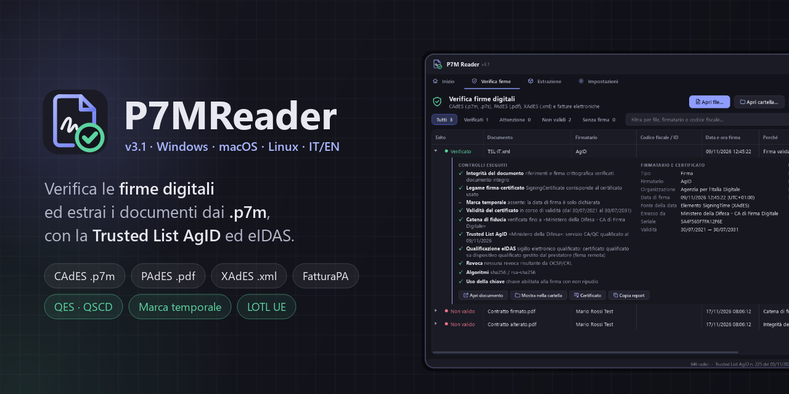

<p align="center">
  
</p>

<p align="center">
  <b>Italiano</b> · <a href="README.en.md">English</a>
</p>

# P7MReader

**Verifica delle firme digitali ed estrazione dei documenti dalle buste `.p7m`, uno alla volta o a migliaia.**
Controlla firme CAdES (`.p7m`, `.p7s`), PAdES (PDF firmati) e XAdES (`.xml`, fatture elettroniche) con catena di fiducia verso la **Trusted List AgID (eIDAS)**, dice per ogni firma *perché* è valida o no, ed estrae i documenti con il nome pulito — **i file restano sul tuo computer**.


## Scarica

Dalla pagina **[Releases](https://github.com/KonjikiNoYami1991/P7MReader/releases/latest)**:

| Sistema | File | Note |
|---|---|---|
| Windows 11 (anche 10) | `P7MReader-<versione>-windows-x64.exe` | Un solo eseguibile, nessuna installazione |
| macOS 12+ fino a macOS 26 Tahoe (Apple Silicon / Intel) | `P7MReader-<versione>-macOS-arm64.dmg` / `-x86_64.dmg` | App non firmata: vedi [primo avvio su macOS](#primo-avvio-su-macos) |
| Linux x86_64 | `P7MReader-<versione>-x86_64.AppImage` oppure `-linux-x86_64.tar.gz` | Vedi [Linux](#linux) qui sotto |

### Primo avvio su macOS

L'app non è firmata da uno sviluppatore registrato Apple, quindi il primo avvio va autorizzato una volta:

- **macOS 15 Sequoia e successivi** (compreso macOS 26 Tahoe): apri l'app, chiudi l'avviso, poi *Impostazioni di Sistema → Privacy e sicurezza → Apri comunque* e conferma. Il vecchio *clic destro → Apri* qui non funziona più.
- **macOS 12-14**: *clic destro sull'app → Apri → Apri*.

In alternativa, dal Terminale, dopo averla copiata in Applicazioni:

```bash
xattr -dr com.apple.quarantine /Applications/P7MReader.app
```

Il file `SHA256SUMS.txt` della release contiene le impronte per controllare l'integrità dei download:

```bash
sha256sum -c SHA256SUMS.txt --ignore-missing
```

## Linux

Ci sono due pacchetti, con lo stesso programma dentro. Funzionano sulle distribuzioni desktop x86_64 con glibc 2.35 o successiva: dalle ultime release (Ubuntu 26.04 LTS e 26.10, Fedora 45, Debian 13, Linux Mint 22, openSUSE Leap 16 e Tumbleweed, Arch, RHEL/AlmaLinux/Rocky 10) fino a Ubuntu 22.04, Debian 12 e Leap 15.6; la [tabella per distribuzione](#distribuzione-per-distribuzione) dice cosa serve su ciascuna). Nessuno dei due richiede permessi di amministratore.

| Pacchetto | Quando sceglierlo |
|---|---|
| **AppImage** | Un solo file da scaricare e avviare, niente installazione. Comodo per provarlo o tenerlo su una chiavetta |
| **tar.gz** | Installazione vera per l'utente: voce nel menu delle applicazioni, icona, comando `p7mreader` nel terminale, apertura dei file con *Apri con…* |

### AppImage: avvio senza installare

```bash
chmod +x P7MReader-*-x86_64.AppImage
```

```bash
./P7MReader-*-x86_64.AppImage
```

Oppure dal file manager: *Proprietà → Permessi → Consenti l'esecuzione come programma*, poi doppio clic.

L'AppImage usa il runtime statico attuale: **non serve `libfuse2`**, basta il programma `fusermount` del pacchetto **`fuse3`**, già presente su quasi tutti i desktop. Se compare `No suitable fusermount binary found on the $PATH`, installalo:

```bash
sudo apt install fuse3
```

(Fedora, RHEL, Arch e openSUSE: pacchetto `fuse3` con `dnf`, `pacman` o `zypper`). In alternativa, senza installare niente:

```bash
./P7MReader-*-x86_64.AppImage --appimage-extract-and-run
```

**Metterlo nel menu delle applicazioni** (facoltativo): il modo più semplice è un gestore di AppImage come *Gear Lever* (Flathub) o *AppImageLauncher*. A mano:

```bash
mkdir -p ~/Applications ~/.local/share/applications ~/.local/share/icons/hicolor/256x256/apps
mv P7MReader-*-x86_64.AppImage ~/Applications/P7MReader.AppImage
cd ~/Applications && ./P7MReader.AppImage --appimage-extract p7mreader.png
mv squashfs-root/p7mreader.png ~/.local/share/icons/hicolor/256x256/apps/ && rm -rf squashfs-root
cat > ~/.local/share/applications/p7mreader.desktop <<EOF
[Desktop Entry]
Type=Application
Name=P7MReader
Exec="$HOME/Applications/P7MReader.AppImage" %F
Icon=p7mreader
Categories=Office;Viewer;Security;
MimeType=application/pkcs7-mime;application/pkcs7-signature;application/pdf;application/xml;
Terminal=false
EOF
```

Per aggiornare basta sostituire `~/Applications/P7MReader.AppImage` con la versione nuova.

### tar.gz: installazione nel sistema (per l'utente corrente)

```bash
tar -xzf P7MReader-*-linux-x86_64.tar.gz
```

```bash
cd P7MReader-*-linux-x86_64
```

```bash
./installa-linux.sh
```

Lo script copia il programma in `~/.local/opt/p7mreader`, crea il comando `p7mreader` in `~/.local/bin` e aggiunge la voce con l'icona nel menu delle applicazioni. Da quel momento P7MReader compare anche in *Apri con…* per i file `.p7m`, `.p7s`, PDF e XML. La cartella estratta si può cancellare.

Se il terminale dice che `p7mreader` non esiste, `~/.local/bin` non è nel `PATH` (succede su alcune distribuzioni finché non si esce e si rientra nella sessione). Si può aggiungere così:

```bash
echo 'export PATH="$HOME/.local/bin:$PATH"' >> ~/.bashrc
```

- **Aggiornare**: estrai il `.tar.gz` della versione nuova e lancia di nuovo `./installa-linux.sh`. Sostituisce il programma e lascia intatte le impostazioni.
- **Disinstallare**: dalla cartella estratta, `./installa-linux.sh --rimuovi`. Le impostazioni e la cache restano in `~/.config/P7MReader`: cancellala a mano se vuoi togliere tutto.
- **Senza installare**: dopo l'estrazione si può avviare direttamente `./P7MReader/P7MReader`.

### Distribuzione per distribuzione

Cosa serve, in breve, sulle famiglie principali. *Pacchetti* = AppImage e tar.gz; *Sorgente* = [avvio da sorgente](#avvio-da-sorgente-su-linux) con Python.

| Famiglia | Esempi | Pacchetti | Sorgente |
|---|---|---|---|
| Debian / Ubuntu | Debian 13 e 12, Ubuntu 26.10, 26.04, 24.04, 22.04, Mint 22 e 21, Pop!_OS, elementary, Zorin | Sì | Sì (Debian 12 e Ubuntu 22.04: Python troppo vecchio, usa `uv`) |
| Fedora | Fedora 45 e 44 (Workstation, KDE), Nobara, Bazzite | Sì | Sì |
| Red Hat | RHEL, AlmaLinux, Rocky 10 | Sì | Sì |
| Red Hat 9 | RHEL, AlmaLinux, Rocky 9 | **No** (glibc 2.34) | Sì, con `python3.12` |
| Arch | Arch, Manjaro, EndeavourOS, CachyOS, Garuda | Sì | Sì |
| openSUSE | Tumbleweed, Leap 16.0 e 15.6 | Sì | Sì |
| Altre | Alpine, Void musl (musl, non glibc) | **No** | Sì |

I pacchetti contengono già Python e Qt: di sistema servono al massimo **`fuse3`** (solo per l'AppImage, di solito c'è già) e qualche **libreria grafica X11** che su desktop minimali può mancare. Per l'avvio da sorgente le librerie grafiche servono sempre, perché PyQt6 installato con `pip` le prende dal sistema.

#### Debian, Ubuntu, Linux Mint e derivate

FUSE per l'AppImage:

```bash
sudo apt install fuse3
```

Librerie grafiche (se compare l'errore sul plugin `xcb`, e sempre per l'avvio da sorgente):

```bash
sudo apt install libegl1 libgl1 libxkbcommon-x11-0 libxcb-cursor0 libxcb-icccm4 libxcb-image0 libxcb-keysyms1 libxcb-render-util0 libxcb-shape0 libxcb-xkb1
```

Per l'avvio da sorgente servono anche:

```bash
sudo apt install python3-venv git
```

#### Fedora

```bash
sudo dnf install fuse3
```

```bash
sudo dnf install mesa-libEGL mesa-libGL libxcb libxkbcommon-x11 xcb-util-cursor xcb-util-wm xcb-util-image xcb-util-keysyms xcb-util-renderutil
```

Per l'avvio da sorgente (Python con `venv` è già incluso):

```bash
sudo dnf install python3 git
```

Su **Fedora Atomic** (Silverblue, Kinoite, Bazzite…) conviene l'AppImage con *Gear Lever*, oppure l'avvio da sorgente dentro `toolbox`.

#### RHEL, AlmaLinux, Rocky Linux

Le **versioni 10** si comportano come Fedora: stessi comandi `dnf` qui sopra.

Le **versioni 9** hanno glibc 2.34, più vecchia della 2.35 richiesta: AppImage e tar.gz **non partono** (errore `GLIBC_2.35 not found`). Si usa l'avvio da sorgente con Python 3.12 (disponibile dalla 9.4):

```bash
sudo dnf install python3.12 git mesa-libEGL mesa-libGL libxcb libxkbcommon-x11 xcb-util-cursor xcb-util-wm xcb-util-image xcb-util-keysyms xcb-util-renderutil
```

Se `xcb-util-cursor` non viene trovato, attiva EPEL (`sudo dnf install epel-release`) e riprova. Nei comandi di [avvio da sorgente](#avvio-da-sorgente-su-linux) scrivi `python3.12` al posto di `python3`.

#### Arch Linux, Manjaro, EndeavourOS, CachyOS

```bash
sudo pacman -S --needed fuse3
```

```bash
sudo pacman -S --needed libglvnd libxcb libxkbcommon-x11 xcb-util-cursor xcb-util-wm xcb-util-image xcb-util-keysyms xcb-util-renderutil
```

Per l'avvio da sorgente:

```bash
sudo pacman -S --needed python git
```

Arch non permette `pip install` nel Python di sistema (PEP 668): l'ambiente virtuale descritto sotto è il modo giusto. Esiste anche `python-pyhanko` su AUR, ma può essere indietro rispetto alla versione su PyPI.

#### openSUSE Tumbleweed e Leap

```bash
sudo zypper install fuse3
```

```bash
sudo zypper install libEGL1 libGL1 libxkbcommon-x11-0 libxcb-cursor0 libxcb-icccm4 libxcb-image0 libxcb-keysyms1 libxcb-render-util0 libxcb-shape0 libxcb-xkb1
```

Per l'avvio da sorgente su Tumbleweed e Leap 16:

```bash
sudo zypper install python3 python3-pip git
```

Su Leap 15.6 il Python predefinito è il 3.6: installa il 3.12 e usa `python3.12` al posto di `python3` nei comandi sotto.

```bash
sudo zypper install python312 python312-pip git
```

#### Altre distribuzioni

- **NixOS**: l'AppImage si avvia con `appimage-run` (`nix-shell -p appimage-run --run "appimage-run ./P7MReader-*-x86_64.AppImage"`).
- **Alpine, Void musl** e altre distribuzioni basate su musl: i pacchetti non funzionano (sono compilati per glibc). Resta l'avvio da sorgente, se la distribuzione fornisce PyQt6 per musl.
- **ARM (aarch64, Raspberry Pi…)**: non ci sono pacchetti precompilati; l'avvio da sorgente funziona dove `pip` trova PyQt6 per quell'architettura.

### Avvio da sorgente su Linux

Dopo aver installato i pacchetti di sistema della tua distribuzione (vedi sopra):

```bash
git clone https://github.com/KonjikiNoYami1991/P7MReader.git
```

```bash
cd P7MReader
```

```bash
python3 -m venv .venv
```

```bash
.venv/bin/pip install PyQt6 pyhanko pyhanko-certvalidator asn1crypto cryptography lxml certifi tzdata
```

```bash
.venv/bin/python P7MReader.py
```

Per controllare che sia tutto a posto, `.venv/bin/python P7MReader.py --selftest` termina con codice 0 e stampa `[OK]` per ogni verifica.

**Python troppo vecchio** (Debian 12, Ubuntu 22.04, Leap 15.x senza `python312`…)? [`uv`](https://docs.astral.sh/uv/) scarica da solo un Python recente nella cartella dell'utente, senza toccare quello di sistema. Al posto dei due comandi `venv` e `pip`:

```bash
curl -LsSf https://astral.sh/uv/install.sh | sh
```

```bash
uv venv --python 3.13 .venv
```

```bash
uv pip install --python .venv PyQt6 pyhanko pyhanko-certvalidator asn1crypto cryptography lxml certifi tzdata
```

Poi si avvia come sopra, con `.venv/bin/python P7MReader.py`.

**Comando `p7mreader`** per l'avvio da sorgente (facoltativo), dalla cartella `P7MReader`:

```bash
mkdir -p ~/.local/bin && printf '#!/bin/sh\nexec "%s/.venv/bin/python" "%s/P7MReader.py" "$@"\n' "$PWD" "$PWD" > ~/.local/bin/p7mreader && chmod +x ~/.local/bin/p7mreader
```

**Aggiornare**: `git pull` nella cartella, poi di nuovo il comando `pip install` con `--upgrade`.

### Se il programma non si apre

- Avvialo da terminale per vedere il messaggio d'errore. Gli errori vengono anche scritti in `~/.config/P7MReader/errori.log`.
- `could not load the Qt platform plugin "xcb"`: manca una libreria grafica di sistema, di solito `libxcb-cursor0` (`sudo apt install libxcb-cursor0`; su Fedora `xcb-util-cursor`).
- Funziona su X11 e su Wayland. Se su Wayland la finestra si comporta in modo strano, prova a forzare X11: `QT_QPA_PLATFORM=xcb p7mreader`.

## Lingua

L'interfaccia è in **italiano** se il sistema è in italiano, altrimenti in **inglese**. Si può scegliere a mano in *Impostazioni → Aspetto → Lingua* (vale dal riavvio successivo).

## Come si usa

1. **Trascina** file o cartelle sulla finestra, oppure usa *Scegli i file…* / *Scegli una cartella…*.
2. Scegli **Verifica firme** o **Estrai documenti**: la tabella si riempie mentre il programma lavora.
3. **Espandi una riga** (doppio clic, oppure Invio) per vedere tutti i controlli eseguiti, il firmatario, il certificato e il documento.
4. Da lì: apri o estrai il documento, apri/esporta il certificato, vedi il riepilogo della fattura elettronica, copia il report.
5. *Report* esporta tutto in **CSV** (Excel) o in una pagina **HTML**.

Da riga di comando i file e le cartelle passati come argomenti vengono aperti subito:

```bash
P7MReader.exe documento.pdf.p7m "C:\Atti firmati"
```

### Scorciatoie da tastiera

| Tasti | Azione |
|---|---|
| `Ctrl+O` | Apri file |
| `Ctrl+Maiusc+O` | Apri cartella |
| `Ctrl+F` | Vai al filtro della tabella |
| `Ctrl+1` … `Ctrl+4` | Inizio, Verifica, Estrazione, Impostazioni |
| `Invio` / `Spazio` | Espandi o chiudi la riga selezionata |
| `Menu` / `Maiusc+F10` | Azioni sulla riga (apri, estrai, certificato, copia…) |
| `Esc` | Annulla l'operazione in corso |
| `Tab` / `Maiusc+Tab` | Spostarsi tra i controlli (il bordo evidenziato mostra dove si è) |

## Il motore di verifica

Per ogni firma (e controfirma) vengono eseguiti e mostrati questi controlli:

| Controllo | Cosa verifica |
|---|---|
| **Integrità del documento** | Impronta del contenuto e firma crittografica (RSA, RSA-PSS, ECDSA, EdDSA). Per i PDF anche le **modifiche dopo la firma**; per XAdES riferimenti, trasformazioni e `SignedInfo` |
| **Legame firma-certificato** | Attributo `signing-certificate` (CAdES/PAdES) o `SigningCertificate` (XAdES) |
| **Marca temporale** | Token RFC 3161 verificato davvero: impronta, firma del token, certificato della TSA. Se è valida, la firma si valuta **a quella data**; viene indicato se la marca è **qualificata eIDAS** |
| **Validità del certificato** | Alla data della marca, oppure (opzione) alla data di firma dichiarata per i certificati scaduti |
| **Catena di fiducia** | Fino a una radice della Trusted List AgID, dell'archivio di Windows o delle CA aggiunte; i certificati intermedi mancanti si scaricano dall'AIA |
| **Trusted List AgID** | Stato del certificatore **alla data della firma**, usando lo storico della lista (servizi poi ritirati o sospesi vengono segnalati) |
| **Qualificazione eIDAS** | QcStatements del certificato + qualificazioni della Trusted List (QSCD, firma o sigillo, criteri di policy): **firma elettronica qualificata (QES)**, sigillo qualificato, firma avanzata con certificato qualificato, firma remota… |
| **Revoca** | OCSP/CRL (soft-fail: se i server non rispondono l'esito diventa *Attenzione* e lo dice) |
| **Algoritmi / uso della chiave** | Algoritmi deboli (SHA-1, MD5, RSA < 2048) e abilitazione del certificato alla firma |

L'esito è **Verificato**, **Attenzione** o **Non valido**, sempre con il motivo (il primo controllo non superato).

### Una Trusted List di cui fidarsi

La Trusted List AgID si scarica a ogni avvio (con copia in cache e copia inclusa nel programma per l'uso offline) e **non viene usata se non è autentica**:

1. la sua firma XAdES viene verificata;
2. il certificato che l'ha firmata deve essere tra quelli che la **Commissione europea** pubblica per l'Italia nella *List of Trusted Lists* (LOTL);
3. se la lista è scaduta (*NextUpdate* superato) viene segnalato.

Una copia scaricata con firma non valida o firmatario sconosciuto viene scartata; una copia locale alterata non viene mai caricata. Lo stato è visibile in *Impostazioni → Radici attendibili* e nella barra di stato.

> P7MReader è uno strumento di verifica tecnica: non è un *servizio di convalida qualificato* ai sensi dell'art. 33 del Regolamento eIDAS e i suoi esiti non hanno valore legale di per sé.

## Estrazione

- Buste `.p7m` anche **annidate** (doppia firma) o in **base64/PEM**.
- **Nome pulito**: spariscono `.pdf (1) (1).p7m`, `.p7m (2)`, ` - Copia`; l'estensione si ricava dal contenuto (PDF, Office, ODF, immagini, XML…).
- Stesso nome e stesso contenuto = *Già presente*; contenuto diverso = `documento (2).pdf`.
- Destinazione accanto agli originali o in una cartella a scelta; opzionalmente elimina il `.p7m` dopo l'estrazione riuscita (mai se la firma non è valida, sempre con conferma).

## Accessibilità

Interfaccia pensata secondo le **WCAG 2.1 livello AA**, senza cambiare l'aspetto grafico:

- **tutto si fa da tastiera** (vedi le scorciatoie) e il **focus è sempre visibile** quando si usa la tastiera;
- **nomi e descrizioni accessibili** per i lettori di schermo (NVDA, Narratore, JAWS); gli esiti colorati hanno sempre anche testo, e i dettagli dei controlli sono letti per intero;
- **contrasto del testo almeno 4,5:1** in tutti e due i temi (chiaro e scuro);
- il testo segue la **dimensione impostata in Windows** (*Accessibilità → Dimensioni testo*);
- le **animazioni** si possono spegnere e restano spente se in Windows sono disattivati gli effetti di animazione;
- il report HTML usa intestazioni di tabella, lingua del documento e testo alternativo per i simboli.

## Avvio da sorgente

Richiede **Python 3.12+** (testato con 3.13 e 3.15). Su Linux segui la guida [avvio da sorgente su Linux](#avvio-da-sorgente-su-linux), con i pacchetti di sistema per ogni distribuzione.

```bash
pip install PyQt6 pyhanko pyhanko-certvalidator asn1crypto cryptography lxml certifi tzdata
```

```bash
python P7MReader.py
```

Prova automatica (moduli, Trusted List, interfaccia), con codice di uscita 0 se tutto è a posto:

```bash
python P7MReader.py --selftest
```

## Compilare l'eseguibile

Windows (exe singolo con icona e informazioni di versione; al termine esegue il selftest e stampa lo SHA-256):

```bash
build_p7mreader.bat
```

macOS e Linux (`.app` + `.dmg`, oppure AppImage + `.tar.gz`):

```bash
./build_p7mreader.sh
```

Le release si costruiscono da sole su GitHub Actions al push di un tag `v*` (es. `v3.1.0`) per Windows, macOS e Linux.

## Dove salva i dati

| Cosa | Dove (Windows) |
|---|---|
| Impostazioni | `%APPDATA%\P7MReader\impostazioni.json` |
| Trusted List AgID e LOTL UE in cache | `%APPDATA%\P7MReader\TSL-IT.xml`, `eu-lotl.xml` |
| Log degli errori | `%APPDATA%\P7MReader\errori.log` |

Su macOS e Linux la cartella è `~/.config/P7MReader`.

**Connessioni di rete**: solo verso la Trusted List AgID, la LOTL della Commissione europea e i server OCSP/CRL/AIA indicati nei certificati. I documenti non vengono mai inviati da nessuna parte.

## Licenza

Distribuito con licenza **GNU GPL v3.0** — vedi [LICENSE](LICENSE).
