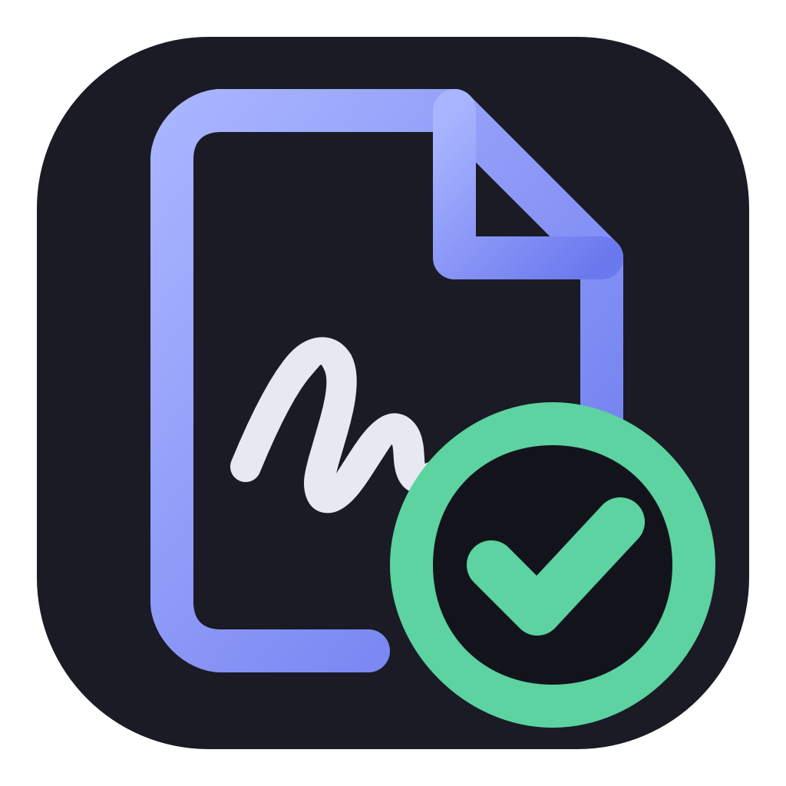
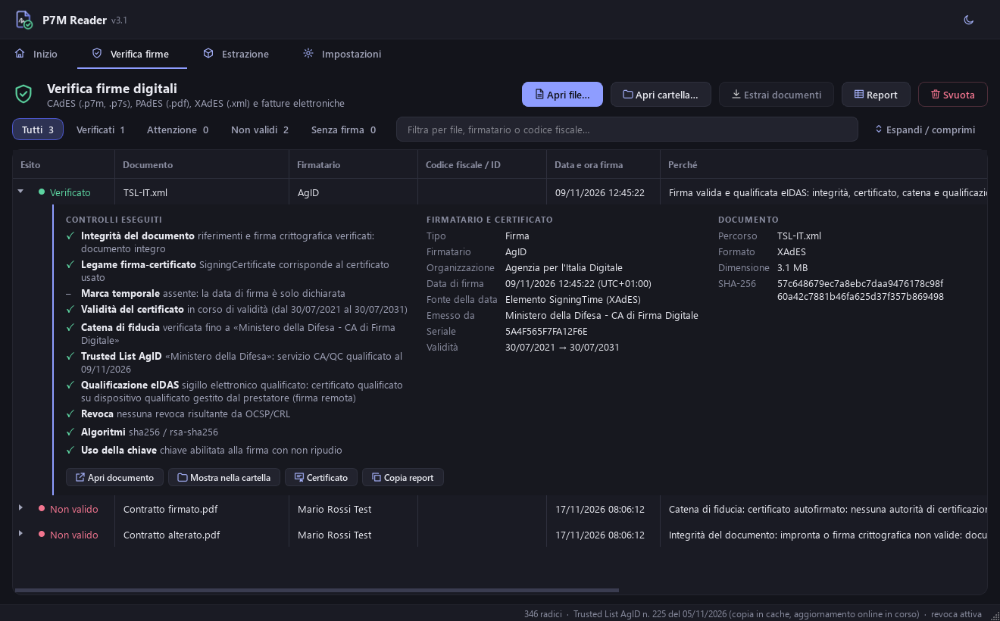

<p align="center">
  
</p>

<p align="center">
  <b>Italiano</b> · <a href="README.en.md">English</a>
</p>

# P7MReader

**Verifica delle firme digitali ed estrazione dei documenti dalle buste `.p7m`, uno alla volta o a migliaia.**
Controlla firme CAdES (`.p7m`, `.p7s`), PAdES (PDF firmati) e XAdES (`.xml`, fatture elettroniche) con catena di fiducia verso la **Trusted List AgID (eIDAS)**, dice per ogni firma *perché* è valida o no, ed estrae i documenti con il nome pulito — **i file restano sul tuo computer**.



## Scarica

Dalla pagina **[Releases](https://github.com/KonjikiNoYami1991/P7MReader/releases/latest)**:

| Sistema | File | Note |
|---|---|---|
| Windows 10/11 | `P7MReader-<versione>-windows-x64.exe` | Un solo eseguibile, nessuna installazione |
| macOS 12+ (Apple Silicon / Intel) | `P7MReader-<versione>-macOS-arm64.dmg` / `-x86_64.dmg` | App non firmata: al primo avvio *clic destro → Apri* |
| Linux x86_64 | `P7MReader-<versione>-x86_64.AppImage` | `chmod +x` e avvio; in alternativa il `.tar.gz` con `installa-linux.sh` |

Il file `SHA256SUMS.txt` della release contiene le impronte per controllare l'integrità dei download.

## Lingua

L'interfaccia è in **italiano** se il sistema è in italiano, altrimenti in **inglese**. Si può scegliere a mano in *Impostazioni → Aspetto → Lingua* (vale dal riavvio successivo).

## Come si usa

1. **Trascina** file o cartelle sulla finestra, oppure usa *Scegli i file…* / *Scegli una cartella…*.
2. Scegli **Verifica firme** o **Estrai documenti**: la tabella si riempie mentre il programma lavora.
3. **Espandi una riga** (doppio clic, oppure Invio) per vedere tutti i controlli eseguiti, il firmatario, il certificato e il documento.
4. Da lì: apri o estrai il documento, apri/esporta il certificato, vedi il riepilogo della fattura elettronica, copia il report.
5. *Report* esporta tutto in **CSV** (Excel) o in una pagina **HTML**.

Da riga di comando i file e le cartelle passati come argomenti vengono aperti subito:

```bash
P7MReader.exe documento.pdf.p7m "C:\Atti firmati"
```

### Scorciatoie da tastiera

| Tasti | Azione |
|---|---|
| `Ctrl+O` | Apri file |
| `Ctrl+Maiusc+O` | Apri cartella |
| `Ctrl+F` | Vai al filtro della tabella |
| `Ctrl+1` … `Ctrl+4` | Inizio, Verifica, Estrazione, Impostazioni |
| `Invio` / `Spazio` | Espandi o chiudi la riga selezionata |
| `Menu` / `Maiusc+F10` | Azioni sulla riga (apri, estrai, certificato, copia…) |
| `Esc` | Annulla l'operazione in corso |
| `Tab` / `Maiusc+Tab` | Spostarsi tra i controlli (il bordo evidenziato mostra dove si è) |

## Il motore di verifica

Per ogni firma (e controfirma) vengono eseguiti e mostrati questi controlli:

| Controllo | Cosa verifica |
|---|---|
| **Integrità del documento** | Impronta del contenuto e firma crittografica (RSA, RSA-PSS, ECDSA, EdDSA). Per i PDF anche le **modifiche dopo la firma**; per XAdES riferimenti, trasformazioni e `SignedInfo` |
| **Legame firma-certificato** | Attributo `signing-certificate` (CAdES/PAdES) o `SigningCertificate` (XAdES) |
| **Marca temporale** | Token RFC 3161 verificato davvero: impronta, firma del token, certificato della TSA. Se è valida, la firma si valuta **a quella data**; viene indicato se la marca è **qualificata eIDAS** |
| **Validità del certificato** | Alla data della marca, oppure (opzione) alla data di firma dichiarata per i certificati scaduti |
| **Catena di fiducia** | Fino a una radice della Trusted List AgID, dell'archivio di Windows o delle CA aggiunte; i certificati intermedi mancanti si scaricano dall'AIA |
| **Trusted List AgID** | Stato del certificatore **alla data della firma**, usando lo storico della lista (servizi poi ritirati o sospesi vengono segnalati) |
| **Qualificazione eIDAS** | QcStatements del certificato + qualificazioni della Trusted List (QSCD, firma o sigillo, criteri di policy): **firma elettronica qualificata (QES)**, sigillo qualificato, firma avanzata con certificato qualificato, firma remota… |
| **Revoca** | OCSP/CRL (soft-fail: se i server non rispondono l'esito diventa *Attenzione* e lo dice) |
| **Algoritmi / uso della chiave** | Algoritmi deboli (SHA-1, MD5, RSA < 2048) e abilitazione del certificato alla firma |

L'esito è **Verificato**, **Attenzione** o **Non valido**, sempre con il motivo (il primo controllo non superato).

### Una Trusted List di cui fidarsi

La Trusted List AgID si scarica a ogni avvio (con copia in cache e copia inclusa nel programma per l'uso offline) e **non viene usata se non è autentica**:

1. la sua firma XAdES viene verificata;
2. il certificato che l'ha firmata deve essere tra quelli che la **Commissione europea** pubblica per l'Italia nella *List of Trusted Lists* (LOTL);
3. se la lista è scaduta (*NextUpdate* superato) viene segnalato.

Una copia scaricata con firma non valida o firmatario sconosciuto viene scartata; una copia locale alterata non viene mai caricata. Lo stato è visibile in *Impostazioni → Radici attendibili* e nella barra di stato.

> P7MReader è uno strumento di verifica tecnica: non è un *servizio di convalida qualificato* ai sensi dell'art. 33 del Regolamento eIDAS e i suoi esiti non hanno valore legale di per sé.

## Estrazione

- Buste `.p7m` anche **annidate** (doppia firma) o in **base64/PEM**.
- **Nome pulito**: spariscono `.pdf (1) (1).p7m`, `.p7m (2)`, ` - Copia`; l'estensione si ricava dal contenuto (PDF, Office, ODF, immagini, XML…).
- Stesso nome e stesso contenuto = *Già presente*; contenuto diverso = `documento (2).pdf`.
- Destinazione accanto agli originali o in una cartella a scelta; opzionalmente elimina il `.p7m` dopo l'estrazione riuscita (mai se la firma non è valida, sempre con conferma).

## Accessibilità

Interfaccia pensata secondo le **WCAG 2.1 livello AA**, senza cambiare l'aspetto grafico:

- **tutto si fa da tastiera** (vedi le scorciatoie) e il **focus è sempre visibile** quando si usa la tastiera;
- **nomi e descrizioni accessibili** per i lettori di schermo (NVDA, Narratore, JAWS); gli esiti colorati hanno sempre anche testo, e i dettagli dei controlli sono letti per intero;
- **contrasto del testo almeno 4,5:1** in tutti e due i temi (chiaro e scuro);
- il testo segue la **dimensione impostata in Windows** (*Accessibilità → Dimensioni testo*);
- le **animazioni** si possono spegnere e restano spente se in Windows sono disattivati gli effetti di animazione;
- il report HTML usa intestazioni di tabella, lingua del documento e testo alternativo per i simboli.

## Avvio da sorgente

Richiede **Python 3.12+** (testato con 3.13 e 3.15).

```bash
pip install PyQt6 pyhanko pyhanko-certvalidator asn1crypto cryptography lxml certifi
```

```bash
python P7MReader.py
```

Prova automatica (moduli, Trusted List, interfaccia), con codice di uscita 0 se tutto è a posto:

```bash
python P7MReader.py --selftest
```

## Compilare l'eseguibile

Windows (exe singolo con icona e informazioni di versione; al termine esegue il selftest e stampa lo SHA-256):

```bash
build_p7mreader.bat
```

macOS e Linux (`.app` + `.dmg`, oppure AppImage + `.tar.gz`):

```bash
./build_p7mreader.sh
```

Le release si costruiscono da sole su GitHub Actions al push di un tag `v*` (es. `v3.1.0`) per Windows, macOS e Linux.

## Dove salva i dati

| Cosa | Dove (Windows) |
|---|---|
| Impostazioni | `%APPDATA%\P7MReader\impostazioni.json` |
| Trusted List AgID e LOTL UE in cache | `%APPDATA%\P7MReader\TSL-IT.xml`, `eu-lotl.xml` |
| Log degli errori | `%APPDATA%\P7MReader\errori.log` |

Su macOS e Linux la cartella è `~/.config/P7MReader`.

**Connessioni di rete**: solo verso la Trusted List AgID, la LOTL della Commissione europea e i server OCSP/CRL/AIA indicati nei certificati. I documenti non vengono mai inviati da nessuna parte.

## Licenza

Distribuito con licenza **GNU GPL v3.0** — vedi [LICENSE](LICENSE).
